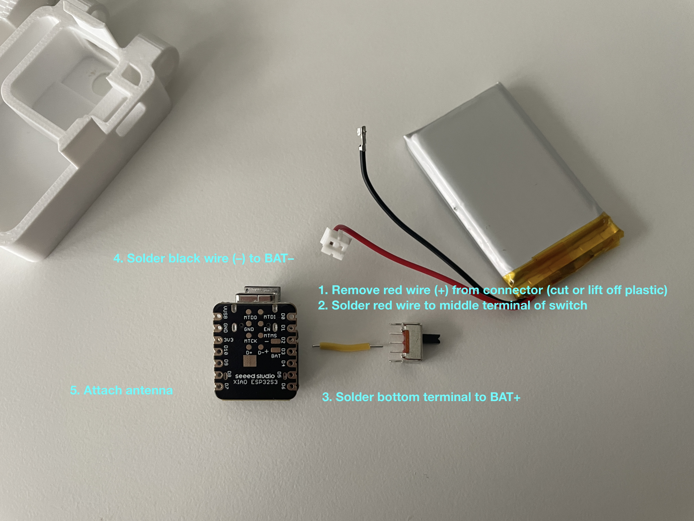
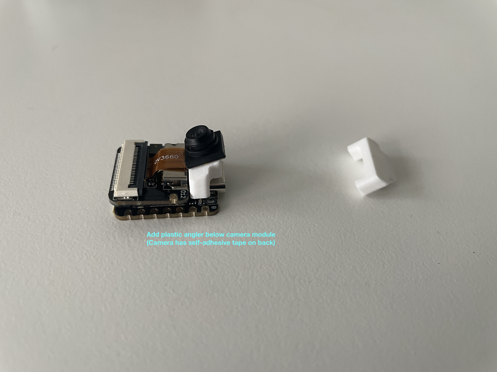
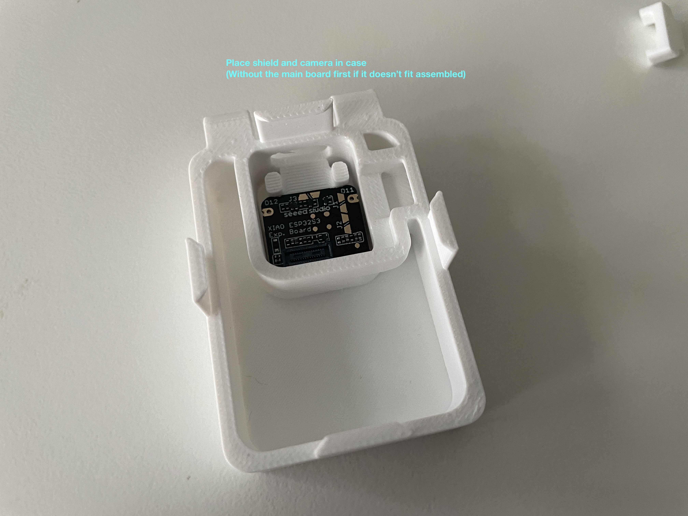
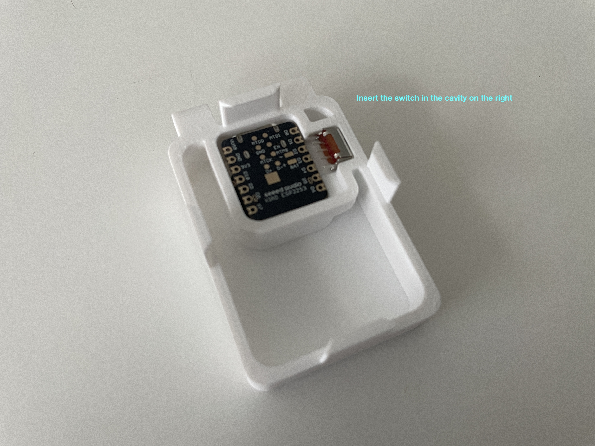
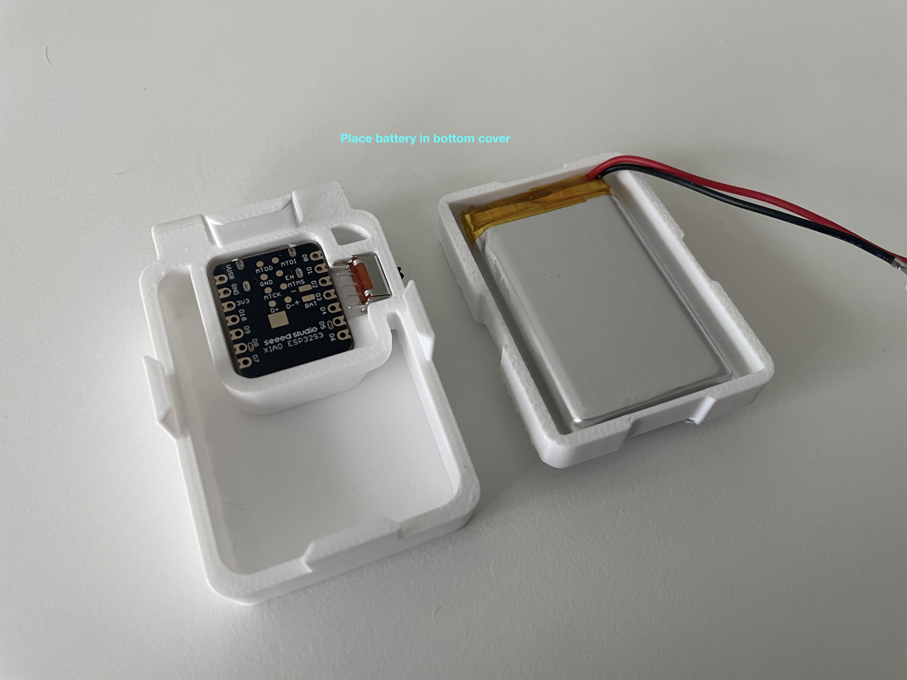
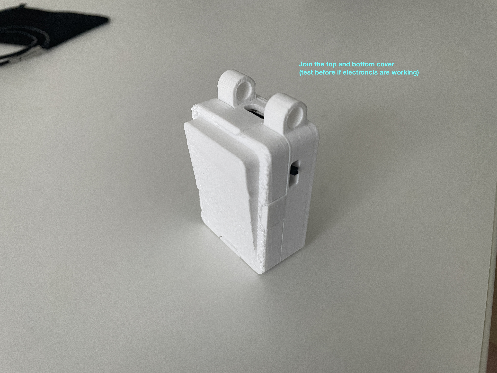
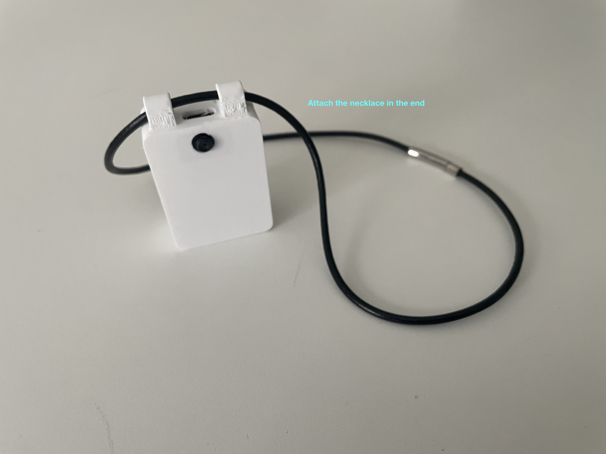

# BLINKS bodycam assembly

The neck-worn bodycam uses a Seeed Studio XIAO ESP32-S3 Sense module. The
battery's positive lead is routed through a slide switch for physical power
control. This variant is called “necklace” in the [original hardware source](../PROVENANCE.md).

**Soldering is required.** Read the complete guide before assembly. Keep USB
disconnected during wiring and enclosure work, prevent the battery leads from
touching, and insulate exposed connections. Do not cut both battery leads at once.

## Parts

- Seeed Studio XIAO ESP32-S3 Sense board with camera expansion board.
- One 3.7 V LiPo cell with JST connector, sized to fit the enclosure.
- SPDT slide switch.
- External snap-on/U.FL antenna.
- Printed [Top](models/Top.stl), [Bottom](models/Bottom.stl) and
  [CamAngler](models/CamAngler.stl) parts.
- Necklace cord.

The imported parts list does not specify every supplier or component dimension.
Check the fit of the cell and switch against the enclosure before ordering.

## Electronics assembly

1. **Free the positive lead.** Remove the red positive wire from the JST
   connector, either by releasing its crimp or cutting only that lead. Keep its
   exposed end insulated from the negative lead and other conductors.
2. **Connect the positive lead to the switch.** Solder it to the middle terminal.
3. **Connect the switched output.** Solder the switch's bottom terminal, as
   oriented in the assembly photo, to the XIAO's BAT+ pad. Confirm which terminal
   pair closes in the intended ON position before wiring.
4. **Connect the negative lead.** Solder the black negative lead to BAT−.
5. **Attach the antenna.** Snap it onto the module's antenna connector and secure
   it with its adhesive pad.

The [bodycam firmware guide](../../camera-firmware/README.md) describes the
recording firmware and flashing setup. Check the electronics before closing the
case, then switch the device off and disconnect USB for mechanical assembly.

## Mechanical assembly

### 1. Add the camera angler

Attach the printed angler below the camera module. Peel the camera's adhesive
backing and attach the camera to the angler.

### 2. Place the expansion board and camera in the case

If the complete assembly will not seat, place the camera expansion board first,
then add the main board.

### 3. Insert the switch

Push the slide switch into the cavity on the right side of the case.

### 4. Place the battery

Lay the cell into the bottom cover without pinching its wires.

### 5. Join the covers

After checking the electronics and switching the device off, bring the top and
bottom covers together until they seat. Keep wires clear of the mating edges.

### 6. Attach the necklace cord

Thread the cord through the enclosure's attachment points.

Continue with the [Android relay application](../../blinks-edge-app/README.md)
and the [main project guide](../../README.md).
