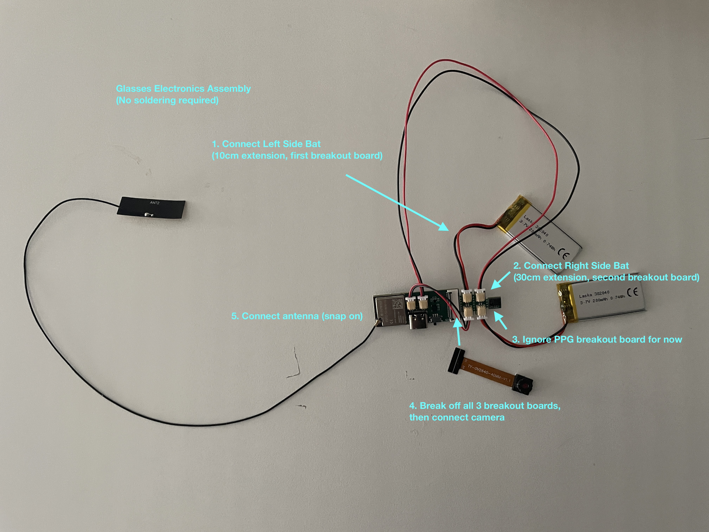
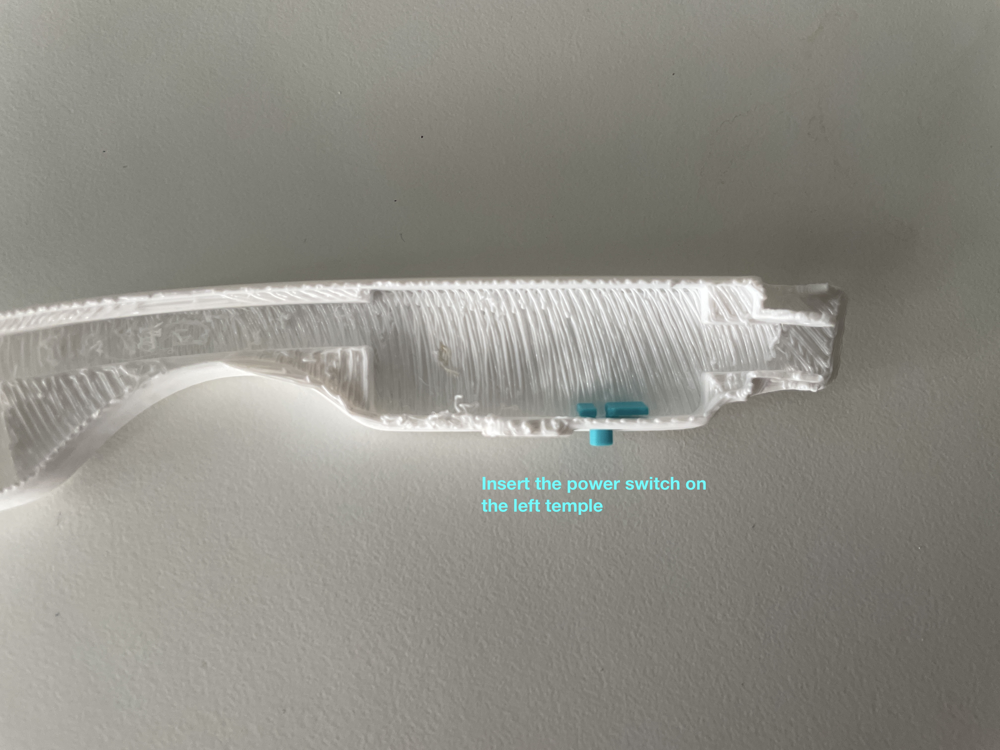
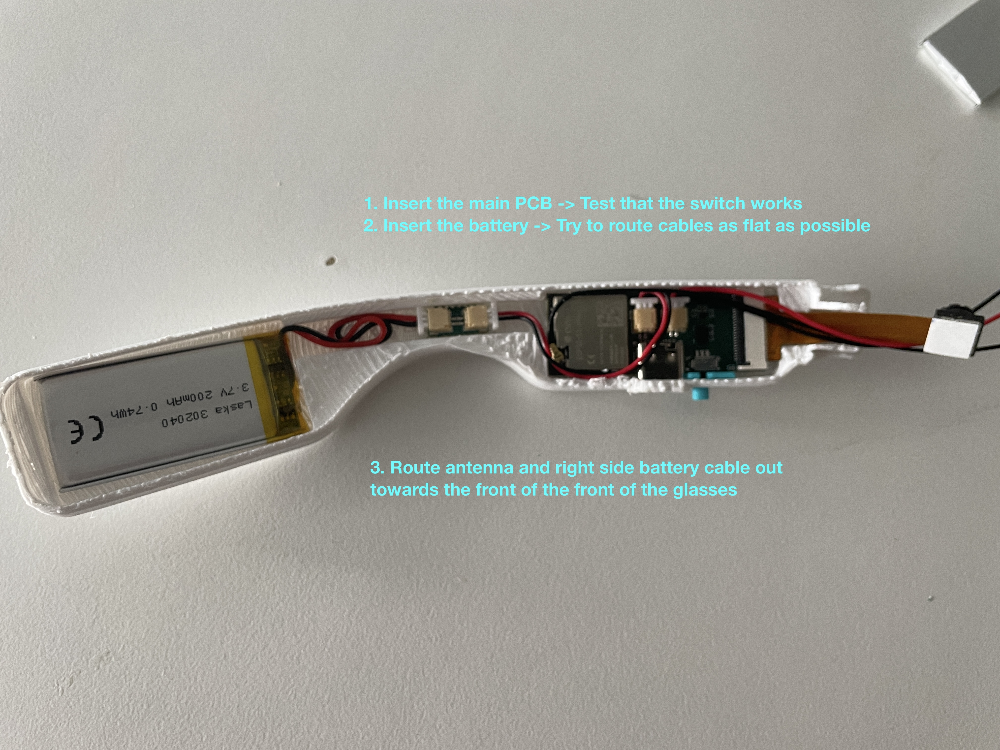
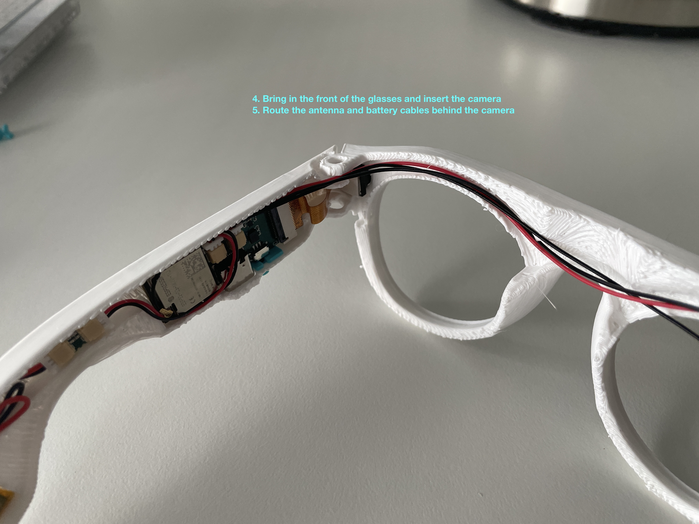
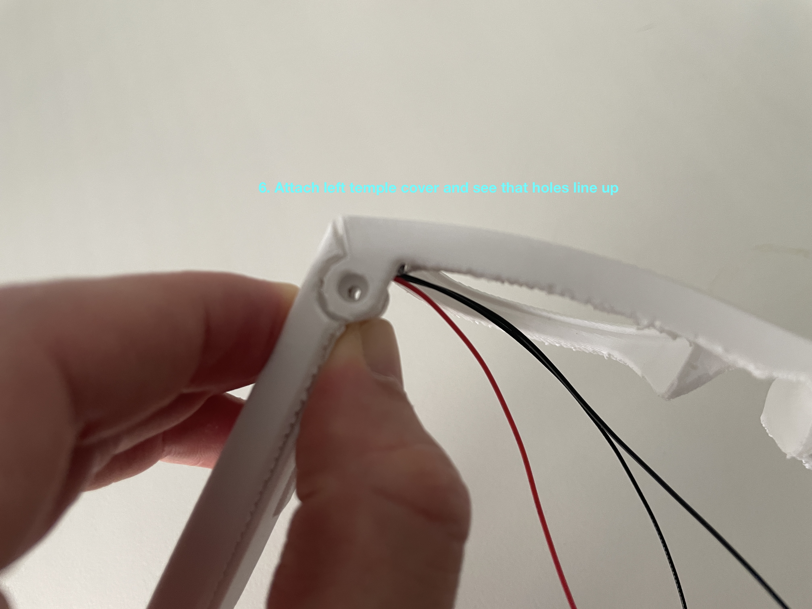
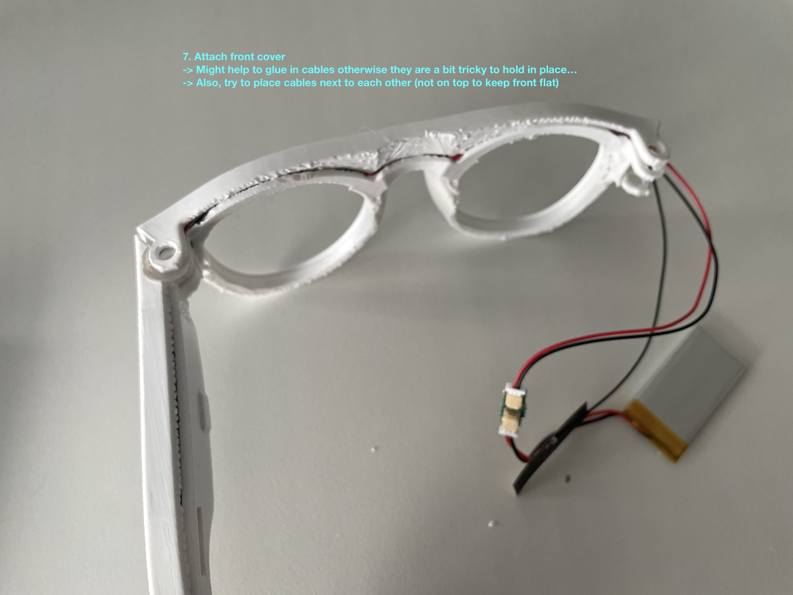
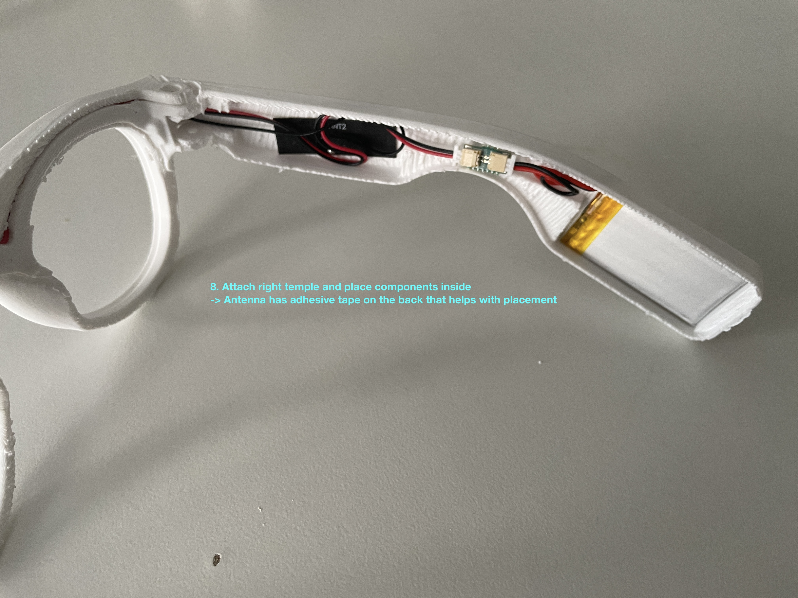
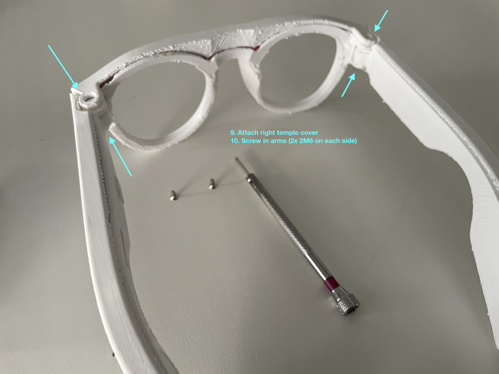
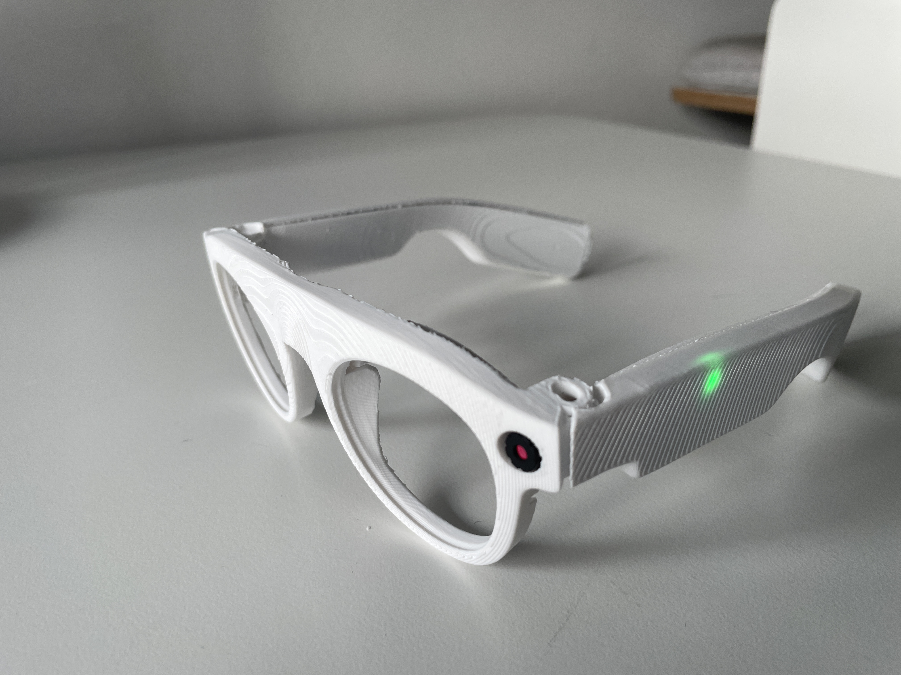
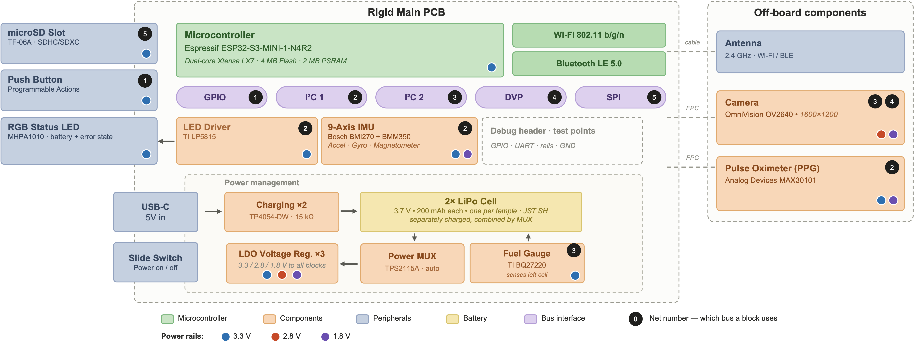

# BLINKS camera glasses

Assembly instructions and seven printable frame parts for the custom ESP32-S3
camera glasses. The guide assumes an existing assembled BLINKS board: schematic,
PCB and fabrication files were not included in the [imported source](../PROVENANCE.md).

**Source-board rework requirement:** the source instructions require removal of
the incorrectly placed load switch U8 before assembly. The subsequent plug-in
assembly is solder-free only after that rework. Identify the board revision and
resolve this requirement before powering it; this guide does not supply the
missing schematic or a rework procedure.

**Assembly is performed without power.** Disconnect USB and both batteries
before separating breakout boards, inserting FPC cables or changing connectors.
Prepare and route the cables before attaching the cells. Verify connector
polarity; matching connector housings alone do not establish correct polarity.

## Parts

- Assembled BLINKS main board with the source-board rework addressed.
- Two 3.7 V, 200 mAh LiPo cells.
- Left battery extension: 10 cm, inverted, with breakout board.
- Right battery extension: 30 cm, inverted, with breakout board.
- TY-OV2640-40MM camera module and its FPC connection.
- ANT2 external snap-on/w.FL antenna.
- PPG breakout board, left disconnected for camera bring-up.
- Four M2×6 screws, two per side.
- The [seven printable frame parts](models/).

| Part | Model |
| --- | --- |
| Outer front | [Front-Outer.stl](models/Front-Outer.stl) |
| Inner front | [Front-Inner.stl](models/Front-Inner.stl) |
| Switch piece | [Switch.stl](models/Switch.stl) |
| Left temple inner | [Temple-Left-Inner.stl](models/Temple-Left-Inner.stl) |
| Left temple outer | [Temple-Left-Outer.stl](models/Temple-Left-Outer.stl) |
| Right temple inner | [Temple-Right-Inner.stl](models/Temple-Right-Inner.stl) |
| Right temple outer | [Temple-Right-Outer.stl](models/Temple-Right-Outer.stl) |

The inner front's original filename was `Frount-Inner.stl`; only the spelling was
changed. Native editable CAD files and manufacturing tolerances are not supplied.

## Electronics preparation

1. With USB and both cells disconnected, separate the three breakout boards along
   their break tabs.
2. Connect the camera to its FPC connector. Open the latch, insert the cable with
   contacts correctly oriented, and close the latch.
3. Snap the antenna onto its connector.
4. Connect the 10 cm inverted extension and first breakout board for the left
   battery, leaving the cell disconnected while fitting and routing components.
5. Prepare the right connection with the 30 cm inverted extension and second
   breakout board in the same way.
6. Leave the PPG breakout board disconnected for initial camera bring-up.

The source reports that the board will not boot from the left battery alone but
will boot from the right battery alone. Preserve this distinction when checking
an existing source board; it is not evidence that its power system has been
independently validated by this import.

Use the [glasses recording firmware](../../glasses-camera-firmware-pio/README.md)
for camera operation. The [LED test](led-test/README.md) checks only the indicator
driver. Any powered check should happen after connectors have been secured;
disconnect power again before further assembly.

## Mechanical assembly

### 1. Insert the power switch

Place the slide switch in the left temple's slot.

### 2. Fit the main board and left battery

Fit the main board and cell with power disconnected. Route cables as flat as
possible, with the antenna and right-battery cables toward the front.

### 3. Fit the front and camera

Insert the camera into the front. Route the antenna and battery cables behind it.

### 4. Attach the left temple cover

Check that the screw holes align and no cable is trapped.

### 5. Attach the front cover

Place cables beside each other rather than stacking them. The source suggests
securing the cables with glue if needed to hold them in position.

### 6. Fit the right temple

Place its components inside and use the antenna's adhesive backing to hold it.

### 7. Check the assembly and close the right temple

Once routing and connectors are complete, verify battery polarity before
connecting the cells for a power check. Switch off again before fitting covers.
Attach the right cover and secure the temples with two M2×6 screws per side.

### 8. Configure recording

The glasses are mechanically assembled. Recording requires the camera firmware
and [Android relay application](../../blinks-edge-app/README.md); see the
[main project guide](../../README.md). Indicator behaviour depends on the
installed firmware, so an illuminated LED alone does not verify image capture.

## Electronics overview

The source describes an ESP32-S3 board with an OV2640 scene camera, BMI270 IMU,
BMM350 magnetometer, MAX30101 PPG module, microSD slot, push button and LP5815
RGB indicator driver. Two LiPo cells have separate charging circuits and feed a
power multiplexer. These are board capabilities; their presence does not imply
that all sensors or local recording are implemented in the camera firmware.

This is a block diagram, not a fabrication schematic. See the
[hardware overview](../README.md) for the available files and remaining gaps.
